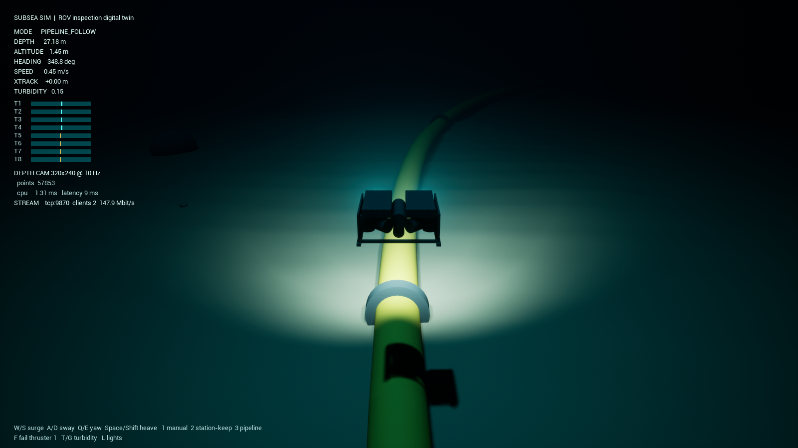
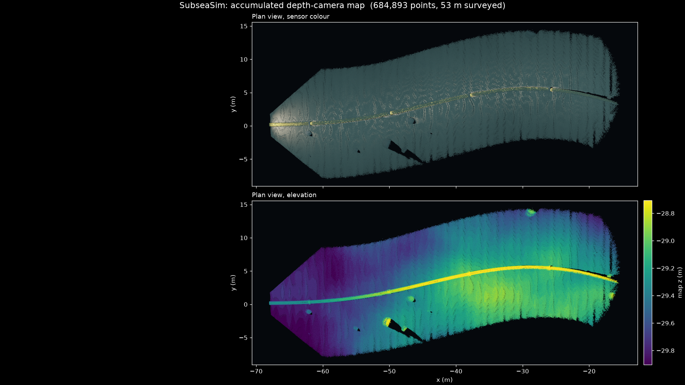

# SubseaSim

[](https://github.com/LasradoStudio/SubseaSim/actions/workflows/ci.yml)

A subsea ROV digital twin in Unreal Engine 5.8: a BlueROV2-Heavy-class vehicle flies an autonomous
pipeline inspection in a procedurally generated site, while a GPU depth camera streams coloured
point clouds and a forward-looking imaging sonar streams images, both to robotics tooling (Rerun today, ROS 2 / RViz2 via the included bridge).

Everything is C++ in a reusable plugin, with no authored art assets and no Blueprint logic, so the
whole simulation is reviewable as text and reproducible from a seed.



*Chase view during an autonomous pipeline survey at 27 m. The HUD shows navigation state, the eight
thruster loads, and the health of the depth camera and sensor stream.*



*685,000-point map fused from 940 depth-camera clouds over a 95 s survey: the pipeline, its flanges,
boulders and the occlusion shadows behind them. Rendered headlessly from the recorded stream.*

## What it does

| Area | Implementation |
|---|---|
| **Hydrodynamics** | Fossen-style 6-DOF model: buoyancy at the centre of buoyancy (passive righting moment), linear + quadratic damping on velocity *relative to the water*, added mass, and a time-varying ocean current. |
| **Actuation** | Eight thrusters with first-order lag and asymmetric forward/reverse limits, in the BlueROV2 Heavy layout. |
| **Thrust allocation** | Damped least-squares pseudo-inverse of the 6xN thruster configuration matrix, with direction-preserving saturation. Re-solved live when a thruster fails. |
| **Guidance and control** | Line-of-sight pipeline following, station keeping and manual modes over PID velocity/depth loops; attitude controlled from vector errors rather than Euler angles. |
| **Depth camera** | Scene colour + depth captured to a float target, read back with a **non-blocking GPU readback**, un-projected to 3D **in parallel on the task graph**, and packed for the wire. Neither the game thread nor the render thread ever waits on the GPU. |
| **Imaging sonar** | 256 beams x 16 rays per ping as engine async traces on worker threads. Echoes spread over each ray's footprint on the surface, with a Lambert-plus-specular backscatter model, absorption, beam overlap, speckle and acoustic shadows, then log-compressed to an 8-bit image and a pilot's fan display. Unaffected by turbidity, as real sonar is. |
| **Sensor realism** | Range noise growing with range squared, Beer-Lambert attenuation and probabilistic dropout driven by water turbidity, camera-style auto exposure. Seeded, so a run is repeatable frame for frame. |
| **Sensor stream** | A dedicated-thread TCP fan-out server with lock-free hand-off, shared immutable frames, and back-pressure that drops bulky frames rather than stall the sim. Documented binary protocol in ROS conventions. |
| **Environment** | Seabed (vertex-coloured silt and scour), pipeline (with free spans where the seabed drops away), flanges, debris, a manifold structure and boulders, all generated from a seed, plus drifting marine snow hidden from the sensors. One material, generated by a Python editor script. Fog and the sensor model share one turbidity value. |
| **Tooling** | Editor menu actions; a remote command channel (mode, fault injection, turbidity ramps, camera shots, HUD, frame recording, fps cap, quit); seven camera shots (chase, orbit, wide, side, top, onboard, flyby); headless automation tests, a benchmark, a scripted shot director, and CI configuration. |
| **Python bridge** | Stream client, Rerun live viewer, recorder with PLY/PCD export, ROS 2 node + Docker/RViz2 setup, and a mock simulator so the pipeline is testable without Unreal. |

## Measured results

All figures below were measured on this project on an i7-14700K / RTX 5090, Unreal 5.8.4,
Development build. They are reproduced by the scripts named in each heading.

**Live survey** (`Scripts/smoke_test.py`, default settings)

| | |
|---|---|
| Depth camera | 320x240 at 10 Hz, about 59,000 points per cloud after range limits and dropout |
| Sensor CPU cost | about 1.1 ms per cloud on worker threads; 9-13 ms capture-to-publish latency |
| Frame rate | about 390 fps with the sensor running and a client attached |
| Tracking | 0.45 m/s survey speed held; cross-track error 0.3 cm RMS |

**Fault injection, water quality and frame rate** (`Scripts/scenario_test.py`)

| Phase | Cross-track RMS | Cross-track max | Speed | Points per cloud | Peak thruster load | Sonar mean level | Frame rate |
|---|---|---|---|---|---|---|---|
| Baseline | 0.3 cm | 1.0 cm | 0.448 m/s | 59,515 | 5 % | 72.7 | 376 fps |
| Horizontal thruster 1 failed | 0.7 cm | 1.7 cm | 0.454 m/s | 60,025 | 10 % | 69.6 | 378 fps |
| Thruster restored | 0.9 cm | 1.7 cm | 0.448 m/s | 59,096 | 5 % | 70.6 | 380 fps |
| Turbidity raised to 0.6 | 0.6 cm | 1.1 cm | 0.447 m/s | 38,543 | 5 % | 70.1 | 362 fps |
| Frame rate capped at 60 | 0.4 cm | 1.2 cm | 0.452 m/s | 58,134 | 5 % | 70.8 | 60 fps |
| Frame rate capped at 30 | 1.3 cm | 3.0 cm | 0.454 m/s | 57,908 | 4 % | 70.2 | 30 fps |

With a thruster dead the allocator redistributes its share across the remaining three horizontal
thrusters (peak load doubles) and the survey continues inside 2 cm. Raising turbidity costs the
depth camera 35 % of its returns, as the attenuation model intends, while the sonar image is unchanged.
Capping the frame rate at 30 fps triples the worst tracking error (1 cm to 3 cm) but stays stable,
because forces are applied once per game tick; moving them into a fixed-step physics callback is
the planned fix (see limitations).

**Un-projection throughput** (`Subsea.Benchmark`, also run by the automation tests)

| Resolution | Points out | Mean | Throughput |
|---|---|---|---|
| 320x240 | 73,885 | 0.92 ms | 83 Mpx/s |
| 640x480 | 295,390 | 3.23 ms | 95 Mpx/s |
| 1280x720 | 901,983 | 6.54 ms | 141 Mpx/s |
| 1920x1080 | 2,029,217 | 16.33 ms | 127 Mpx/s |

**Sonar**: 4,096 rays per ping at 10 Hz, about 8 ms from ping to formed image, with the simulation
still at about 350 fps.

**Tests**: 8 Unreal automation tests (frame conversion, thrust allocation including a failed
thruster, PID convergence and anti-windup, damping, wire protocol, un-projection geometry and
determinism, sonar acoustics and image formation, benchmark) and 65 Python tests, all passing. Three stream clients were run
concurrently against one simulation during the survey above.

## Run it

Requirements: Unreal Engine 5.8, Visual Studio 2022 Build Tools (MSVC 14.44, Windows SDK),
Python 3.10+.

```powershell
.\Scripts\build.ps1        # compile
.\Scripts\run_demo.ps1     # simulation + live point-cloud viewer
.\Scripts\test.ps1         # headless Unreal + Python tests; add -Live for the smoke and scenario tests
```

The ROV starts in autonomous pipeline-follow mode. Controls: `W/S` surge, `A/D` sway, `Q/E` yaw,
`Space/Shift` heave, `1/2/3` manual / station-keep / pipeline-follow, `F` fail thruster 1,
`T/G` turbidity, `L` lights, `C` camera shot. Touching a movement key hands control back to the pilot.

Recording footage: launch with `-UseFixedTimeStep -FPS=30` and run a shot list,
`python Scripts/direct.py Scripts/shots/film.json`; each frame advances exactly 1/30 s of
simulation however long it takes to capture, so the footage is judder-free. `Scripts/make_film.py`
and `Scripts/render_sensor_video.py` assemble the film and render the point-cloud and sonar views.

Other entry points:

```powershell
cd Bridge
.\.venv\Scripts\python.exe -m subsea_bridge.recorder --duration 60 --ply map.ply   # fuse a map
.\.venv\Scripts\python.exe ..\Scripts\render_map.py map.ply map.png                # render it
.\.venv\Scripts\python.exe -m subsea_bridge.mock_sim                               # stand-in sim, no Unreal
```

In the editor, **Tools > Subsea Sim** adds an inspection site and ROV to the open level and exports
the live cloud to `.ply` during Play In Editor.

### ROS 2 / RViz2

`Bridge/subsea_bridge/ros2_bridge.py` republishes the stream as `sensor_msgs/PointCloud2`,
`nav_msgs/Odometry`, `/tf` (`map -> base_link`), `/tf_static` (the rigid `depth_cam` and `sonar`
mounts) and the sonar as `sensor_msgs/Image` (`sonar/raw` polar mono8, `sonar/image` the rgb8 fan).
`Bridge/docker/rviz/subsea.rviz` shows the cloud, TF, odometry trail and sonar.

**Run on Windows with WSL** (tested: Ubuntu 24.04, ROS 2 Jazzy, WSL 3.0.5, NAT networking):

```powershell
wsl --install -d Ubuntu-24.04                                       # once (WSL itself needs admin)
wsl -d Ubuntu-24.04 -u root -- bash Scripts/wsl/setup_ros2.sh  # once, from the repo root
.\Scripts\run_demo.ps1 -NoViewer -BindAll       # the sim, listening where WSL can reach it
.\Scripts\wsl\run_ros2.ps1                      # bridge + RViz2
```

Measured live: point clouds 9.9 Hz (59k points, ~95 Mbit/s), odometry 30 Hz, sonar and telemetry
10 Hz (`Scripts/wsl/ros2_rates.py`); 215 of 216 clouds resolved through TF at their stamp, the miss
being the first cloud before any pose arrived (`Scripts/wsl/tf_check.py`).

Notes from getting it running:

- **Networking.** WSL's mirrored mode could not reach Windows services here (connections timed out,
  even to a plain Python server), so the scripts use the default NAT mode: the sim binds all
  interfaces (`-BindAll`) and the bridge connects to WSL's default gateway, the Windows host.
- **Static mounts.** The sim re-sends the sensor mounts every tick. Sent on `/tf` they made about 3 %
  of RViz2's cloud lookups fail with extrapolation errors; sent once on `/tf_static` they don't.
- **GPU.** Mesa falls back to software rendering (2 fps in RViz2). `ros2_up.sh` selects WSLg's D3D12
  driver on the NVIDIA adapter, which gives 30 fps with a 10 s cloud trail while the sim runs at 30.
- **Footage.** `Scripts/wsl/record_ros2_demo.ps1` records both windows at once (Desktop Duplication
  for Unreal, x11grab for RViz2) and `Scripts/make_ros2_clip.py` composes them side by side.

The Docker setup in `Bridge/docker` (same bridge, same RViz config): CI builds the image on every
push, but running it (`docker compose up` with RViz2 in a container) has not been tried.

## Layout

```
Plugins/SubseaSim/Source/SubseaSim/      runtime module
  Math/        frame conversion (Unreal <-> ROS), thrust allocation
  Control/     PID
  Physics/     hydrodynamics, thrusters
  Sensors/     GPU depth camera -> point cloud, imaging sonar
  Net/         wire protocol, stream server
  Vehicle/     ROV pawn: guidance, control, allocation
  World/       procedural inspection site
  Game/        game mode and HUD
  Tests/       automation tests
Plugins/SubseaSim/Source/SubseaSimEditor/  editor menu tooling
Bridge/                                    Python package, tests, Docker/ROS 2
Scripts/                                   build, test, demo, smoke/scenario tests, map renderer
Docs/PROTOCOL.md                           wire format
```

The game module is deliberately empty: the plugin is the product and can be dropped into another
project unchanged.

## Design notes

**Why not `ReadPixels`?** It flushes rendering commands and blocks the game thread for the GPU
round trip, so sensor cost lands directly on frame time and grows with resolution.
`FRHIGPUTextureReadback` queues the copy and is polled on later frames; the only cost is a few
frames of latency, which is reported in telemetry rather than hidden.

**Threading.** Three hand-offs, each with one owner: the game thread schedules captures, the render
thread owns the readback queue, workers own un-projection. Shared state is a reference-counted
block that outlives the component if work is still in flight. Un-projection splits rows into bands
with a private output array and a private seeded random stream per band, so the result is identical
regardless of thread count or scheduling.

**Coordinate frames.** Unreal is left-handed in centimetres, ROS right-handed in metres. The
conversion is a mirror, which treats vectors and pseudovectors (angular velocity, quaternion axes)
differently; that distinction lives in one header and is tested by checking that rotating then
converting equals converting then rotating.

**Added mass.** Chaos bodies have scalar mass, so the mean added mass is folded into the body's
mass and the spurious extra weight cancelled. This keeps the solve implicit; an explicit `-Ma * a`
force is unstable once added mass approaches the dry mass, which it does for an ROV.

**Sim-to-real.** One turbidity parameter drives both what the pilot sees (fog) and what the sensor
returns (attenuation, dropout), so the two cannot drift apart. Hydrodynamic coefficients are the
published BlueROV2 Heavy values and are plain properties, ready to be replaced by tank-test data.

## Known limitations

- Damping is the decoupled diagonal form; Coriolis/centripetal terms and off-diagonal added mass are not modelled.
- Thrust is a first-order lag on force; there is no propeller model, battery sag or thruster-hull interaction.
- The depth camera models an ideal pinhole with range noise and dropout; there is no lens distortion, refraction at the housing port or backscatter.
- Forces are applied once per game tick rather than in an async physics callback, so the model assumes physics sub-stepping is off.
- The vehicle and site are built from primitives with one generated material.
- The sonar is a ray-traced approximation: no multipath, no surface reverberation, no beam sidelobes beyond neighbour overlap.
- The camera fill light in the external shots is presentation lighting, not part of the vehicle.

## How this was built

Designed and directed by Neil Lasrado, using Claude Code (Anthropic) as an AI pair programmer; commits carry a `Co-Authored-By` line for it. Every figure under [Measured results](#measured-results) comes from an actual run, not an estimate.

## Licence

MIT, see [`LICENSE`](LICENSE). Unreal Engine itself is under Epic's own licence and is not included.
